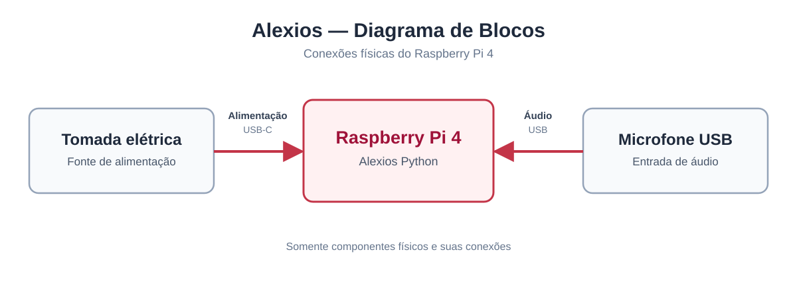

# Assistente de Voz Alexios — Raspberry Pi 4

Luigi Lauand Botto - 23.01066-5  
Luigi de Menezes Collesi - 23.00625-0  
Enzo Pistori Fontenelle de Oliveira - 23.00768-5

Este repositório contém o código Python e a documentação técnica do **Alexios**, um cliente local para um assistente de voz em português. O cliente recebe áudio do microfone, identifica voz, turnos e locutores, transcreve as falas e envia eventos ao [Alexios Web](https://github.com/luigicollesi/alexios-web), responsável pela inteligência conversacional, memória, interface e síntese de voz. A montagem física documentada considera um **Raspberry Pi 4**, um **microfone USB** e a alimentação elétrica pela tomada.

---

## 📋 Sumário

1. [Visão Geral do Projeto](#-visão-geral-do-projeto)
2. [Arquitetura do Sistema](#-arquitetura-do-sistema)
3. [Especificações de Hardware](#-especificações-de-hardware)
4. [Conexões Físicas](#-conexões-físicas)
5. [Evolução do Desenvolvimento](#-evolução-do-desenvolvimento)
6. [Software e Protocolo de Comunicação](#-software-e-protocolo-de-comunicação)
7. [Estrutura do Repositório](#-estrutura-do-repositório)
8. [Testes e Demonstração](#-testes-e-demonstração)
9. [Como Executar o Projeto](#-como-executar-o-projeto)

---

## 🔍 Visão Geral do Projeto

O Alexios utiliza captura contínua de áudio e reconhecimento local para organizar a conversa em turnos. Seu cliente Python identifica quando alguém fala, determina os limites dos turnos, realiza a transcrição em português e reconhece locutores por identificadores temporários. O processamento da conversa, a escolha da resposta, a memória, o avatar e a voz ficam no servidor Alexios Web.

O **Raspberry Pi 4** representa o computador responsável pela captura e pelo processamento local do áudio. A arquitetura também permite executar o cliente em outro computador compatível, conforme os requisitos de software.

---

## 🛠 Arquitetura do Sistema

O diagrama abaixo representa **somente as conexões físicas** solicitadas: alimentação do Raspberry Pi 4 pela tomada, por meio de uma fonte USB-C adequada, e microfone conectado à porta USB do Raspberry Pi 4.



**[Abrir diagrama de blocos](docs/diagrama_blocos.svg)**

### Fluxo de funcionamento

1. **Entrada de áudio:** o microfone USB entrega amostras de áudio ao Raspberry Pi 4.
2. **Detecção de voz e turnos:** o cliente identifica fala e determina quando um turno termina.
3. **Transcrição e identificação:** o áudio é transcrito localmente, com identificação do locutor.
4. **Envio dos eventos:** o cliente envia os eventos por HTTPS ao Alexios Web.
5. **Resposta:** o servidor decide o que responder e controla a interface, o avatar e a síntese de voz.

O diagrama físico **não** representa os serviços remotos, por não fazerem parte da montagem elétrica. A divisão entre cliente e servidor está detalhada em [docs/architecture.md](docs/architecture.md).

---

## ⚙️ Especificações de Hardware

| Componente | Função principal | Especificação / observação |
| :--- | :--- | :--- |
| **Raspberry Pi 4** | Computador que executa o cliente Python | Processamento local do áudio e comunicação com o servidor |
| **Microfone USB** | Captura de voz | Conectado diretamente a uma porta USB do Raspberry Pi 4; deve ser reconhecido pelo sistema e pelo PortAudio |
| **Fonte de alimentação** | Alimentação elétrica | Fonte USB-C compatível com os requisitos do Raspberry Pi 4 |
| **Tomada elétrica** | Alimentação da fonte | Fornece energia ao conjunto |

O microfone é uma entrada de áudio; a reprodução de voz é gerenciada pelo Alexios Web e sua interface de áudio. Não são necessários GPIOs ou circuitos eletrônicos adicionais para a ligação do microfone USB.

---

## 📌 Conexões Físicas

| Origem | Destino | Conexão | Finalidade |
| :--- | :--- | :--- | :--- |
| **Tomada elétrica** | **Raspberry Pi 4** | Fonte de alimentação USB-C apropriada | Fornecer energia ao dispositivo |
| **Microfone USB** | **Raspberry Pi 4** | Porta USB | Capturar as falas do ambiente |

Antes de iniciar o programa, confirme que o sistema reconhece o microfone utilizando `python main.py --list-devices` e `python main.py --mic-test 5`.

---

## 📐 Evolução do Desenvolvimento

A implementação foi organizada para manter um **único ponto principal de execução** (`main.py`), com responsabilidades distribuídas entre captura, detecção de voz, transcrição, identificação de locutores e envio de eventos. As interfaces HTTP de presença ainda usam caminhos `/v2/agent/*` por compatibilidade, enquanto os eventos de conversa seguem o protocolo `/v3/agent/*`. Esses caminhos não representam dois modos de execução do cliente.

O cliente mantém áudio bruto e embeddings de locutores localmente, enquanto o Alexios Web concentra a inteligência conversacional e a memória. As decisões e os contratos técnicos estão descritos em [docs/architecture.md](docs/architecture.md).

---

## 💻 Software e Protocolo de Comunicação

O projeto utiliza **Python 3.12** e os seguintes componentes:

| Componente | Responsabilidade |
| :--- | :--- |
| **PortAudio** | Acesso ao dispositivo de microfone |
| **Silero VAD** | Detecção de atividade de voz |
| **Smart Turn** | Estimativa de encerramento de turno |
| **faster-whisper** | Transcrição local das falas |
| **CAM++** | Identificação de locutores |
| **Alexios Web** | Recepção dos eventos, inferência, memória, avatar e voz |

O cliente consulta `/v2/agent/poll` e informa seu estado em `/v2/agent/state`. Para a conversa, utiliza `/v3/agent/sync`, `/v3/agent/activity`, `/v3/agent/chunk`, `/v3/agent/turn` e `/v3/agent/floor`. O envio identifica os eventos de forma estável para evitar duplicações em tentativas de reenvio.

---

## 📁 Estrutura do Repositório

| Caminho | Descrição |
| :--- | :--- |
| **`main.py`** | Ponto principal de execução e argumentos da aplicação |
| **`agent/`** | Captura, modelos, turnos, transcrição, identificação, filas e comunicação |
| **`config/`** | Vocabulário e configurações auxiliares |
| **`scripts/`** | Download de modelos, avaliações e benchmarks |
| **`tests/`** | Testes automatizados dos componentes e contratos |
| **`docs/architecture.md`** | Arquitetura lógica e responsabilidades do cliente |
| **`docs/diagrama_blocos.svg`** | Diagrama de blocos da montagem física |
| **`.env.example`** | Modelo das variáveis de ambiente |
| **`requirements.txt`** | Dependências Python |
| **`README.md`** | Documentação principal do projeto |

---

## 🧪 Testes e Demonstração

O projeto possui testes automatizados para validar os principais componentes do cliente:

```bash
python -m unittest discover -s tests -v
python -m compileall -q main.py agent scripts tests
```

Também foi produzido um **registro audiovisual de demonstração do Alexios em funcionamento**, com a interface web, o avatar e as respostas da conversa. O vídeo original da demonstração é `IMG_9476.mp4` (aproximadamente 2 minutos e 39 segundos). **O MP4 não está versionado neste repositório**; esta descrição não substitui o arquivo audiovisual.

A gravação demonstra a utilização do sistema, mas, isoladamente, não comprova que o processamento foi executado no Raspberry Pi 4. O diagrama representa a montagem física prevista.

---

## 🚀 Como Executar o Projeto

### Instalação

É necessário **Python 3.12**, microfone reconhecido pelo PortAudio e conexão com um servidor Alexios Web configurado.

```bash
git clone https://github.com/luigicollesi/alexios.git
cd alexios
python3.12 -m venv .venv
source .venv/bin/activate
python -m pip install -r requirements.txt
python scripts/download_models.py
cp .env.example .env
```

Configure `ALEXIOS_BRIDGE_URL`, `ALEXIOS_AGENT_TOKEN` e `ALEXIOS_INSTANCE_ID` no arquivo `.env`. **Não publique credenciais.**

### Verificação do microfone e execução

```bash
python main.py --list-devices
python main.py --mic-test 5
python main.py --model base --model-threads 1
```

Para reduzir o custo de processamento, é possível experimentar `--model tiny`; para avaliar a qualidade de transcrição, utilize `--model small`. O desempenho varia conforme o hardware. Use `--device N` para selecionar um dispositivo e `--debug-audio` para diagnósticos. Consulte `python main.py --help` para a lista completa de parâmetros.

**Privacidade:** informe as pessoas presentes antes de ativar a escuta. Áudio bruto e embeddings dos locutores permanecem locais, enquanto texto transcrito e identificadores de locutores são encaminhados ao servidor.
